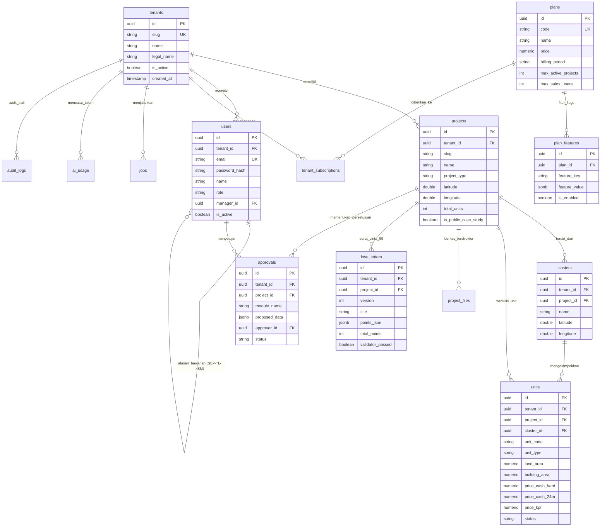

# Entity-Relationship Diagram (ERD) — Developer Sales OS

Skema database PostgreSQL: `sales_os`
Domain Target: `developerproperti.giivepro.com`

---

## 1. Visualisasi Mermaid ERD



---

## 2. Hierarki Multi-Tenant & Aturan Isolasi

```
Tenant (Developer/PT)
 └── Subscriptions (Plan: Gold / Platinum / Diamond)
 └── Users (SUPERADMIN, OWNER, SM, TL, SE, DIGITAL_MARKETING)
      └── Hierarki Supervisi: SE -> TL (AI) -> SM (Semi-AI)
 └── Projects (The Park Townhouse Sukoharjo, dll)
      ├── Clusters (Nagoya, Osaka, Tokyo)
      │    └── Units (30 Unit Kavling)
      ├── Project Files (/storage/{tenant_id}/{project_id}/...)
      └── Love Letters (99 Poin Editorial Berversi v1, v2)
```

Setiap entitas bisnis mengikat `tenant_id` secara wajib dan difilter pada seluruh query pembacaan dan mutasi.
