# Entity-Relationship Diagram (ERD) — Developer Sales OS

Skema database PostgreSQL: `sales_os`  
Domain Target: `developerproperti.giivepro.com`

---

## 1. Visualisasi Mermaid ERD (Lengkap Fase 1, 1A, & 1B)

```mermaid
erDiagram
    tenants ||--o{ org_profile : "profil_kuesioner"
    tenants ||--o{ org_roles : "struktur_tim_dan_ai"
    tenants ||--o{ projects : "memiliki"
    tenants ||--o{ users : "memiliki"
    tenants ||--o{ tenant_subscriptions : "berlangganan"
    tenants ||--o{ hook_events : "analitik_hook"
    tenants ||--o{ jobs : "antrean_job_ai"
    tenants ||--o{ ai_usage : "audit_token"
    tenants ||--o{ audit_logs : "audit_trail"
    
    plans ||--o{ plan_features : "fitur_flags"
    plans ||--o{ tenant_subscriptions : "diaktifkan_pada"
    
    users ||--o{ project_members : "penugasan_proyek"
    users ||--o{ project_assignment_requests : "mengajukan_penugasan"
    users ||--o{ product_quiz_results : "skor_kuis_se"
    
    projects ||--o{ project_members : "anggota_tim"
    projects ||--o{ clusters : "terdiri_dari"
    projects ||--o{ units : "memiliki_unit"
    projects ||--o{ product_sources : "berkas_asli"
    projects ||--o{ kb_facts : "sumber_kebenaran_kb"
    projects ||--o{ location_facts : "jarak_haversine"
    projects ||--o{ kb_chunks : "semantik_kb"
    projects ||--o{ love_letters : "surat_cinta_99"
    projects ||--o{ market_research : "riset_pasar_v1_vN"
    projects ||--o{ sales_targets : "target_penjualan_v1_vN"
    projects ||--o{ content_calendars : "kalender_konten_v1_vN"
    projects ||--o{ project_playbooks : "playbook_se_tl_sm"
    projects ||--o{ daily_routes : "rute_gps_kanvasing"
    projects ||--o{ project_websites : "landing_page_proyek"
    projects ||--o{ project_leads : "pipeline_crm_7_stages"
    projects ||--o{ project_pipeline_stages : "jalur_proyek_8_tahap"
    projects ||--o{ approvals : "approval_rekomendasi"
    
    tenants ||--o{ commission_rules : "aturan_bagi_komisi"
    content_calendars ||--o{ calendar_slots : "90_slot_30_hari"
    
    clusters ||--o{ units : "mengelompokkan"
    clusters ||--o{ location_facts : "titik_pusat_haversine"

    product_sources ||--o{ kb_facts : "menghasilkan_fakta"
    kb_facts ||--o{ kb_changes : "riwayat_perubahan"
```



---

## 2. Rincian Entitas Baru Fase 1A & 1B

### A. Product Knowledge Base (Fase 1A)
- `product_sources`: Berkas asli (brosur, pricelist, denah) dengan periode berlaku, versi, dan hash.
- `kb_facts`: Fakta terstruktur terverifikasi (`fact_id`, kategori, kunci, nilai, sumber kutipan, confidence, flag `boleh_publik`).
- `location_facts`: Jarak garis lurus Haversine dan estimasi waktu berkendara terverifikasi per cluster.
- `kb_chunks`: Potongan teks untuk pencarian semantik.
- `kb_changes`: Riwayat perubahan fakta produk (`dikoreksi_manual`).
- `product_quiz_results`: Riwayat hasil kuis 10 soal SE baru (lulus minimal 80%).

### B. Organisasi, Penugasan Proyek, & Mode Demo (Fase 1B)
- `org_profile`: Profil PT, rentang headcount, kanal media sosial, alat lead, target penjualan.
- `org_roles`: Headcount dan mode AI (`human_only`, `semi_ai`, `full_ai`) per role.
- `project_members`: Relasi penugasan user ke proyek (`bisa_menyetujui_penugasan` untuk SM / Owner). Default: 1 proyek.
- `project_assignment_requests`: Alur pengajuan dan persetujuan penugasan ke proyek tambahan.
- `hook_events`: Pencatatan kartu ajakan mikro (`displayed`, `closed`, `cta_clicked`, `converted`).
- `tenants`: Kolom status akun `DEMO` (30 hari), `teaser_visible_percent` (25%).

### C. Riset Pasar & Target Penjualan (Fase 2)
- `market_research`: Menyimpan riset pasar per versi proyek (`personas` JSONB min 5 persona, `public_facilities` JSONB radius 500m-25km, `competitors` JSONB, `market_share_analysis` JSONB SVG).
- `sales_targets`: Rencana penjualan per versi proyek (`total_units`, `avg_price_idr`, `total_target_revenue`, `scenarios` JSONB konservatif/realistis/optimis, `monthly_schedules` JSONB dengan reverse funnel, `se_targets` JSONB per headcount).
- `project_pipeline_stages`: Status 8 tahap berurutan (`input`, `surat_cinta_99`, `riset_pasar`, `target_penjualan`, `kalender_konten`, `playbook`, `rute_harian`, `website_landing`).

### D. Kalender Konten Media Sosial (Fase 3)
- `content_calendars`: Rencana kalender konten bulanan per proyek (`month_period`, `active_platforms` JSONB, `has_sales_track`, `total_slots`, `completed_slots`).
- `calendar_slots`: 90 slot konten terjadwal (`day_number` 1..30, `slot_order` 1..3, `funnel_stage` TOFU/MOFU/BOFU, `track` OFFICIAL/SALES_IN_HOUSE, `platform`, `format`, `title`, `brief`, `caption`, `hashtags`, `cta`, `source_fact_id`, `source_love_letter_point`, `status`, `posted_url`).

### E. Playbook Sales & Rute Harian GPS Kanvasing (Fase 4)
- `project_playbooks`: Standar operasional taktis per proyek & per peran (`role` SE/TL/SM, `version`, `ai_mode`, `monthly_unit_target`, `reverse_funnel_targets` JSONB, `bant_criteria` JSONB, `daily_sop` JSONB, `weekly_sop` JSONB, `monthly_sop` JSONB, `kpi_metrics` JSONB).
- `daily_routes`: Panduan rute lapangan GPS harian (`day_name`, `route_name`, `start_coordinates` JSONB, `waypoints` JSONB terpetakan ke RS/bank/sentra niaga, `total_distance_km`, `estimated_hours`, `hourly_schedule` JSONB).

### F. Project Website Generator & Simulator Cicilan (Fase 5)
- `project_websites`: Konfigurasi landing page proyek (`subdomain`, `custom_domain`, `site_title`, `hero_headline`, `hero_subheadline`, `units_config` JSONB, `faqs_config` JSONB, `simulation_defaults` JSONB, `is_published`, `standalone_html`).

### G. CRM Pipeline & Aturan Komisi (Fase 6)
- `project_leads`: Data prospek melekat pada proyek (`full_name`, `phone_whatsapp`, `email`, `source`, `stage` 7 canonical stages, `bant_scores` JSONB, `assigned_se_name`, `assigned_tl_name`, `subordinate_label_tag`, `next_follow_up_date`, `next_action_plan`, `notes`, `estimated_value_idr`).
- `commission_rules`: Kebijakan persentase bagi komisi tingkat tenant (`company_share_percent`, `sm_share_percent`, `tl_share_percent`, `se_share_percent`, `affiliator_share_percent`, total = 100%).

---

## 3. Aturan Isolasi Data Tingkat Tenant & Proyek

```
Tenant (Developer/PT)
 ├── Status: DEMO (30 Hari) / AKTIF / DEMO_BERAKHIR
 ├── org_profile + org_roles -> effective_features()
 ├── commission_rules (Aturan komisi 100%: PT, SM, TL, SE, Affiliator)
 └── Projects (Data Melekat Pada Proyek)
      ├── Project Members (SE / TL / SM / Admin) -> Wajib Approval Penugasan
      ├── Knowledge Base (kb_facts dengan fact_id)
      ├── Jalur Proyek (project_pipeline_stages: 8 Tahap)
      ├── Surat Cinta 99 Keunggulan (v1, v2)
      ├── Riset Pasar (market_research: 5 Persona & Cincin 500m - 25km)
      ├── Target Penjualan (sales_targets: 3 Skenario s.d. Sold Out 100%)
      ├── Kalender Konten (content_calendars: 30 Hari x 3 Slot/Hari = 90 Slot)
      ├── Playbook Sales (project_playbooks: SE, TL, SM & BANT >= 7)
      ├── Rute Harian (daily_routes: GPS Mandan - Solo Baru)
      ├── Landing Page (project_websites: thepark.developerproperti.giivepro.com)
      ├── CRM Pipeline (project_leads: 7 Tahap, Tagging Bawahan, Follow-Up Date)
      ├── Clusters (Nagoya, Osaka, Tokyo) -> Koordinat Asli
      └── Units -> Akad/Closing (Aktual Pendapatan) vs Booking (Pipeline)
```
